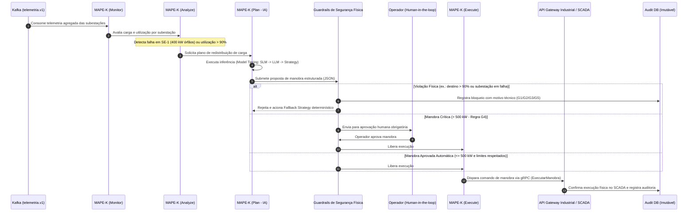

# Resiliência e Integração

**Responsável:** Darlan Rodrigues Schmeller (Pesquisador & Engenheiro de Resiliência e Integração)  
**Projeto:** Gird the Grid — Architectural Kata  
**Status:** Documentação Técnica e Especificação Arquitetural

---

## 1. Visão Geral e Escopo

A camada de **Resiliência e Integração** é a espinha dorsal de conectividade do **Gird the Grid**. Ela é encarregada de suportar o fluxo contínuo de dados provenientes de mais de **100.000 a 1.900.000 medidores inteligentes IoT** e dezenas de estações SCADA/RTU, garantindo que eventos de campo sejam ingeridos, validados, normalizados e disponibilizados para os consumidores de negócio e para o ciclo autonômico MAPE-K com altíssima disponibilidade (99,99%) e tolerância a falhas severas.

---

## 2. Arquitetura de Ingestão de Telemetria IoT

O fluxo completo de ponta a ponta é estruturado em camadas desacopladas:

```
[Medidores IoT / SCADA] 
       │ (MQTT/TLS ou HTTPS/mTLS)
       ▼
[API Gateway Industrial (EMQX / Envoy)]
       │ (Payload bruto)
       ▼
[Serviço de Ingestão (.NET 8)]
  ├─ ConectorFactory (Factory Method)
  ├─ Adapters (ScadaAdapter / MedidorAdapter)
  ├─ Validação de Schema (JSON Schema telemetria.v1)
  └─ Kafka Producer (Idempotent, acks=all, chave=tenantId:medidorId)
       │
       ├─── (Payload inválido / Poison Pill) ───────► [Tópico telemetria.dlq]
       │
       ▼
[Cluster Apache Kafka]
  ├─ Tópico telemetria.v1 (Particionado por tenant:medidor)
  └─ Tópicos de Controle / Auditoria
       │
       ├───────────────────────────────┐
       ▼                               ▼
[Worker de Regras]             [Serviço Autonômico MAPE-K]
(Consumer Group: rules-workers)  (Consumer Group: mapek-engine)
  │                              │
  ├─ Retry + Exp. Backoff        ├─ Monitor / Analyze
  ├─ DLQ em falhas esgotadas     ├─ IA Model Tiering (SLM/LLM)
  └─ Persistência Idempotente:   ├─ Guardrails Físicos Determinísticos
     - TimescaleDB (Métricas)    └─ Atuação de Manobra (gRPC)
     - Audit DB (Imutável)
```

### 2.1. Protocolos de Comunicação na Borda
1. **Medidores Inteligentes Residenciais e Comerciais:**
   - **Protocolo:** MQTT sobre TLS 1.3 (porta 8883), utilizando autenticação mTLS baseada em certificados X.509 individuais por dispositivo.
   - **Formato:** JSON compacto codificado em UTF-8.
   - **QoS:** MQTT QoS 1 (*At least once*) com persistência local de buffer no medidor em caso de queda de rede local de telecomunicação celular/mesh.
2. **Sistemas SCADA e RTUs (Subestações e Redes de Transmissão):**
   - **Protocolo:** HTTPS com mTLS ou TCP direto protegido por VPN/IPSec.
   - **Formato:** Payloads legados baseados em XML (ex.: padrão IEC 61850 / IEC 60870-5-104 serializado ou DNP3 sobre IP).

### 2.2. Responsabilidades do API Gateway Industrial
- **Terminação TLS e Autenticação de Dispositivos:** Verificação criptográfica do certificado do medidor e revogação via CRL/OCSP.
- **Isolamento de Rede e Rate Limiting:** Proteção contra ataques de negação de serviço (DoS) e tempestades de reconexão (*reconnection storms*), aplicando *Token Bucket* com vazão máxima por medidor.
- **Roteamento Interno:** Encaminhamento do tráfego TCP/MQTT decodificado para o pool de instâncias do Serviço de Ingestão.

### 2.3. Normalização e Validação (Serviço de Ingestão)
O Serviço de Ingestão aplica padrões de projeto estruturais GoF para garantir desacoplamento total:
- **Factory Method (`ConectorFactory`):** Inspeciona o cabeçalho/tipo de conexão e instancia o conector apropriado para a fonte.
- **Adapter (`ScadaAdapter` e `MedidorAdapter`):** Converte formatos heterogêneos para o DTO canônico do domínio. O `ScadaAdapter`, por exemplo, converte campos legados (`<PointValue meter="MTR-1" kWh_raw="1520000" volt="219.5"/>`) para o formato unificado do domínio (`{"tenantId": "...", "medidorId": "MTR-1", "potenciaKw": 1520.0, ...}`).
- **Validação Antecipada de Schema:** O payload traduzido é validado rigorosamente contra o contrato formal `telemetria.v1`. Caso viole o schema, o pacote é imediatamente descartado para a Dead Letter Queue (`telemetria.dlq`) com cabeçalhos de diagnóstico, sem sobrecarregar o tópico principal de eventos.

---

## 3. Arquitetura e Engenharia do Apache Kafka

Para suportar 100.000 a 1.900.000 medidores com fluxo contínuo de 19.000 eventos/s (picos de 57.000 eventos/s), o cluster Apache Kafka é configurado sob as seguintes diretrizes:

### 3.1. Topologia de Tópicos e Particionamento
- **Tópico Principal:** `telemetria.v1`.
- **Estratégia de Particionamento:**
  - O particionamento é distribuído com base no hash murmur2 da **chave composta: `tenantId:medidorId`**.
  - **Garantia Arquitetural:** Todos os eventos de uma mesma unidade consumidora são obrigatoriamente alocados na mesma partição física, assegurando a **ordenação estrita temporal** das leituras de potência e tensão.
  - O prefixo `tenantId` evita que medidores de identificadores idênticos em concessionárias distintas colidam ou misturem histórico, viabilizando consumo isolado.
- **Dimensionamento das Partições:**
  - Hipótese de dimensionamento: Cada partição suporta com folga 1.000 a 2.000 eventos/s de gravação contínua. Para uma taxa de pico de 57.000 eventos/s, o tópico `telemetria.v1` é configurado inicialmente com **48 a 64 partições**, permitindo paralelismo horizontal de até 64 workers por consumer group.

### 3.2. Configuração do Produtor (Serviço de Ingestão)
- **`enable.idempotence = true`:** O produtor Kafka anexa um Producer ID (PID) e número de sequência a cada lote de mensagens, garantindo semântica de entrega **exatamente-uma vez (*exactly-once*)** na camada de transporte do broker, impedindo duplicações por retentativas de rede.
- **`acks = all` (`-1`):** A mensagem só é confirmada após a replicação bem-sucedida em todos os nós do *In-Sync Replicas* (ISR).
- **`compression.type = zstd`:** Alta taxa de compressão com baixíssimo consumo de CPU, reduzindo o tráfego de rede e footprint de I/O em até 60%.
- **`batch.size = 64KB` e `linger.ms = 10`:** Otimização para agregação de registros em lotes sem adicionar latência perceptível humana (< 10 ms).

### 3.3. Configuração do Broker e Replicação
- **Modo do Cluster:** Apache Kafka com KRaft (*Kafka Raft Metadata mode*), eliminando a dependência do Apache ZooKeeper.
- **Fator de Replicação (`replication.factor = 3`):** Cada partição possui uma réplica líder e duas seguidoras distribuídas em zonas de disponibilidade distintas (*Availability Zones*).
- **`min.insync.replicas = 2`:** Garante que mesmo com a queda de um broker, as gravações continuam operando com garantia estrita de durabilidade.
- **Política de Retenção:**
  - `retention.ms = 604800000` (7 dias) com limpeza via `delete`.
  - Permite replay histórico completo para auditorias regulatórias do PRODIST ou reprocessamento do ciclo MAPE-K em caso de ajuste de modelos de IA.

### 3.4. Consumer Groups e Offset Management
- **Consumer Group 1 (`rules-workers`):** Lê os eventos, aplica regras operacionais, verifica limites de consumo e persiste de forma idempotente no TimescaleDB e Audit DB.
- **Consumer Group 2 (`mapek-engine`):** Agrega telemetria contínua por subestação e calcula métricas em janelas de tempo deslizantes para alimentar a fase *Monitor* do gerenciador autonômico.
- **Gerenciamento de Offset:** `enable.auto.commit = false`. O offset só é consolidado manualmente (*commitSync* ou *commitAsync* em bloco) após o processamento bem-sucedido e persistência do lote.

---

## 4. Padrões de Resiliência e Tolerância a Falhas

A arquitetura aplica padrões de resiliência diferenciando de forma rigorosa as interações **síncronas (HTTP/REST/gRPC)** e o processamento **assíncrono de eventos (Kafka)**:

```mermaid
flowchart TD
    subgraph INGRESSO[Borda e Comunicação Síncrona]
        REQ[Chamada HTTP Legado / Operador] --> CB{Circuit Breaker<br/>Polly}
        CB -->|Circuito Fechado| SRV[Serviço Externo / Legado]
        CB -->|Falhas seguidas >= 3| ABERTO[Circuito Aberto]
        ABERTO --> FB[Fallback: Retorna Cache / Degradação Graciosa]
        SRV -->|Timeout > 2s| RETRY[Retry com Exponential Backoff + Jitter]
        RETRY -->|Esgotou 3 tentativas| ABERTO
    end

    subgraph STREAMING[Processamento de Mensagens Kafka]
        KMSG[Mensagem do Tópico telemetria.v1] --> WORKER[Worker Consumer]
        WORKER --> VAL{Validação Estrutural / Schema}
        VAL -->|Incompatível / Poison Pill| DLQ1[(telemetria.dlq)]
        VAL -->|Válido| PROC[Processamento de Regras / BD]
        PROC -->|Falha Transitória BD| KRETRY[Retry em Memória / Tópico de Retry]
        KRETRY -->|Backoff 1s, 2s, 4s, 8s| PROC
        KRETRY -->|Esgotou tentativas| DLQ2[(telemetria.dlq)]
        PROC -->|Sucesso| COMMIT[Commit Manual do Offset]
    end
```



### 4.1. Análise Comparativa dos Mecanismos de Resiliência

| Mecanismo | Aplicação em Comunicação Síncrona (HTTP/REST) | Aplicação em Mensageria Kafka |
|---|---|---|
| **Timeout** | Essencial (ex.: 2s nas chamadas a sistemas legados). Evita que threads fiquem bloqueadas indefinidamente (*thread starvation*). | Utilizado no `poll(timeout)` e no envio de mensagens do produtor (`delivery.timeout.ms`). |
| **Retry & Exponential Backoff** | Repete chamadas transitórias com intervalos progressivos (1s, 2s, 4s) com *Jitter* para evitar sincronismo de manada. | Executado em caso de indisponibilidade momentânea do TimescaleDB antes de realizar o commit do lote. |
| **Circuit Breaker** | **Altamente recomendado (Polly):** Abre o circuito após 3 falhas consecutivas, protegendo o sistema legado e respondendo imediatamente via Fallback. | **Não aplicável de forma direta ao consumo do Kafka.** Interromper o consumo paralisa a partição. Em vez de abrir circuito, o consumidor pausa o consumo (`pause()`) ou redireciona mensagens problemáticas para o tópico de retry/DLQ. |
| **Dead Letter Queue (DLQ)** | Inexistente nativamente (substituído por logging e resposta de erro HTTP 4xx/5xx). | **Fundamental (`telemetria.dlq`):** Isola *poison pills* e mensagens recalcitrantes, permitindo que a partição continue avançando sem travar. |
| **Idempotência** | Implementada via chaves de idempotência em cabeçalhos HTTP (`Idempotency-Key`). | Garantida por transações atômicas no produtor Kafka (`enable.idempotence=true`) e cláusulas `ON CONFLICT DO UPDATE / NOTHING` no banco TimescaleDB baseadas no `(medidorId, timestamp)`. |
| **Load Leveling** | Inexistente (requisições síncronas disputam conexões imediatamente). | **Característica nativa:** O log particionado absorve 57.000 eventos/s enquanto os consumidores processam na capacidade ideal dos servidores. |

---

## 5. Matriz Completa de Falhas e Recuperação

| Componente | Falha Possível | Causa Raiz Típica | Impacto no Sistema | Estratégia de Mitigação e Recuperação |
|---|---|---|---|---|
| **Medidores IoT** | Perda de conectividade celular/mesh | Rompimento de fibra da operadora ou tempestade | Interrupção do envio de telemetria em tempo real | **Buffer Local e Reenvio:** Medidor armazena dados em memória não-volátil (flash) e retransmite com timestamp original ao restabelecer o link. |
| **API Gateway Industrial** | Saturação por tempestade de conexões (*storm*) | Reenergização em massa de bairro após blackout | Sobrecarga de CPU/memória e rejeição de conexões | **Rate Limiting e mTLS Throttling:** Algoritmo Token Bucket limita reconexões; balanceador de carga escala horizontalmente novos nós de gateway. |
| **Serviço de Ingestão** | Falha de processo ou container OOM | Vazamento de memória ou sobrecarga de alocação | Queda temporária de réplicas de ingestão | **Auto-Restart e Redirecionamento:** Kubernetes/Docker orquestra reinício automático; balanceador redireciona o tráfego para réplicas saudáveis; sem perda de dados graças ao buffer do gateway. |
| **Apache Kafka** | Queda abrupta de um broker líder | Falha de hardware ou kernel panic | Indisponibilidade momentânea da partição líder | **Eleição de Líder e Replicação:** Réplicas ISR elegem novo líder em < 2 segundos; produtores redirecionam lotes automaticamente (`acks=all`, `min.insync.replicas=2`). |
| **Consumidores (Workers)** | Falha de processamento (*Poison Pill*) | Payload com schema inesperado ou campo nulo | Potencial travamento da partição do consumidor | **Isolamento em DLQ:** Mensagens com erro definitivo são enviadas diretamente para `telemetria.dlq` sem bloquear o processamento das mensagens subsequentes. |
| **TimescaleDB** | Exaustão do pool de conexões / Queda | Sobrecarga de queries analíticas simultâneas | Falha na persistência dos dados de telemetria | **Retry com Backoff e Lag Temporário:** Workers pausam o consumo do Kafka, mantendo os dados seguros no log do broker até a recuperação do banco. |
| **Serviço de IA (MAPE-K)** | Timeout na geração de plano pelo modelo | Complexidade de inferência ou latência de rede no LLM | Atraso no cálculo de redistribuição de carga | **Model Tiering e Fallback Determinístico:** Caso o SLM/LLM não responda em < 2s, aciona o fallback determinístico via padrão Strategy (`ProporcionalFolga`). |
| **Cadastro Legado** | Indisponibilidade do serviço SOAP/REST legado | Manutenção de infraestrutura corporativa | Falha na consulta de metadados de clientes | **Polly Circuit Breaker + Cache:** Abre o circuito após 3 falhas consecutivas, servindo metadados a partir do cache local sem derrubar os workers. |

---

## 6. Integração com o Ciclo Autonômico MAPE-K

O gerenciador autonômico do Gird the Grid implementa o ciclo MAPE-K com inteligência artificial nativa (*AI-Native*), operando em conjunto com a espinha dorsal de eventos:



### 6.1. Detalhamento das Etapas MAPE-K
1. **Monitor:** Lê continuamente os eventos do Kafka através de um consumer group dedicado (`mapek-engine`), calculando médias móveis e níveis de carregamento dos alimentadores em janelas de 10 segundos.
2. **Analyze:** Identifica condições anômalas, tais como interrupção de envio de telemetria em subestação (sintoma de curto-circuito/falha) ou alimentador operando acima de **90% de sua capacidade nominal**, quantificando os megawatts que precisam ser transferidos.
3. **Plan:** Aciona a arquitetura de **Model Tiering**:
   - **Tier 1 (SLM Local):** Modelo leve executado on-premises para baixa latência (< 500ms) e sem saída de dados da concessionária.
   - **Tier 2 (LLM em Nuvem):** Acionado se o Tier 1 falhar ou retornar payload inconsistente.
   - **Tier 3 (Fallback Determinístico - GoF Strategy):** Caso a IA falhe ou estoure o timeout de 2 segundos, o sistema aciona algoritmos determinísticos clássicos de engenharia elétrica (`ProporcionalFolga` ou `MaiorFolgaPrimeiro`).
4. **Execute:** Converte o plano homologado em comandos de atuação de campo, enviando-os ao SCADA via gRPC através do API Gateway Industrial.
5. **Knowledge:** Base de conhecimento alimentada por restrições topológicas, limites físicos nominais dos transformadores, histórico de contingências e um **Banco Vetorial (Qdrant)** com manuais técnicos e normativas do PRODIST/ANEEL.

---

## 7. Guardrails de Segurança Física e Determinismo

> [!IMPORTANT]
> **Princípio Fundamental:** A Inteligência Artificial atua exclusivamente como consultora probabilística; o sistema de Guardrails determinístico detém a autoridade executiva final. Nenhuma manobra elétrica é realizada diretamente pela IA sem validação por código determinístico.

### 7.1. Regras Operacionais dos Guardrails (G1 a G5)
- **G1 (Isolamento de Falha):** É terminantemente proibido transferir carga para uma subestação cujo status operacional seja `FALHA` ou `MANUTENÇÃO`.
- **G2 (Margem Operacional de 90%):** Nenhuma subestação receptora pode ultrapassar **90% de sua capacidade nominal** após a conclusão da manobra, preservando 10% de margem dinâmica para absorver surtos e variações térmicas.
- **G3 (Conservação de Carga e Não-Alucinação):** A carga requisitada na manobra deve ser obrigatoriamente um valor real positivo e menor ou igual à carga disponível/excedente na subestação de origem ($\Delta P \le P_{origem}$). Valores discrepantes ou negativos gerados por alucinação da IA são sumariamente descartados.
- **G4 (Supervisão Humana - *Human-in-the-Loop*):** Qualquer remanejamento de carga que envolva potência superior a **500 kW** exige validação e autorização explícita de um operador no Web App SPA antes do disparo do comando.
- **G5 (Isolamento Multi-tenant Estrito):** Subestações de origem e destino devem obrigatoriamente pertencer à mesma concessionária (`tenantId`). É impossível interconectar redes de operadoras distintas.

### 7.2. Auditoria e Rastreabilidade Total
Todas as propostas geradas pela IA — aprovadas, bloqueadas ou submetidas ao operador humano — são registradas com assinatura criptográfica no **Audit DB imutável (PostgreSQL append-only)** e replicadas para o SIEM corporativo, garantindo conformidade regulatória com o módulo 8 do PRODIST e com a LGPD.
