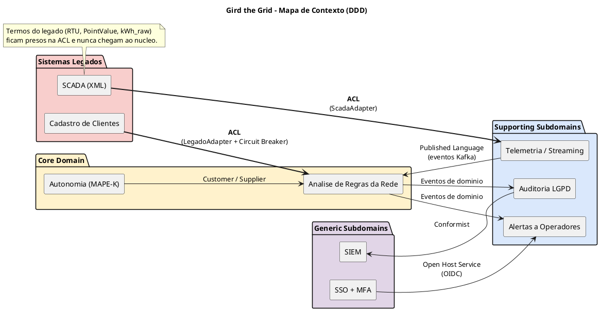

# Domain-Driven Design (DDD) & Limites de Contexto

**Responsável:** João Souza (Pesquisador & Modelagem DDD)

## 1. Classificação dos Subdomínios

| Subdomínio | Tipo | Justificativa |
|---|---|---|
| Monitoramento da Rede e Balanceamento Autônomo de Carga | **Core Domain** | Diferencial do produto: detectar falhas e redistribuir carga sozinho, com segurança |
| Ingestão de Telemetria | Supporting | Necessária, mas sem regra de negócio exclusiva |
| Auditoria e Compliance LGPD | Supporting | Obrigatória por lei; trilha imutável |
| Alertas a Operadores | Supporting | Notificação e aprovação humana de manobras |
| Autenticação SSO com MFA | Generic | Solução de mercado |
| SIEM | Generic | Produto de terceiros |
| Cadastro de Clientes (legado) | Generic | Sistema existente da concessionária |

## 2. Bounded Contexts e Linguagem Ubíqua

| Bounded Context | Termos da Linguagem Ubíqua | Pacote |
|---|---|---|
| **Análise de Regras da Rede** | Subestação, Carga, Capacidade, Utilização, Sobrecarga, Falha | `br.com.girdthegrid.analiseregrasnegocio` |
| **Autonomia (MAPE-K)** | Monitor, Análise, Plano, Execução, Guardrail, Manobra | `br.com.girdthegrid.autonomia` |
| **Telemetria / Streaming** | Leitura, Medidor, Tenant, Partição | `br.com.girdthegrid.streamingingestao` |
| **Auditoria** | Evento de Auditoria, Trilha Imutável | `br.com.girdthegrid.persistenciainfra` (AuditDbAdapter) |
| **Integração Legada** | termos do legado (`RTU`, `PointValue`, `kWh_raw`, `COD_CLI`) traduzidos na ACL | `br.com.girdthegrid.persistenciainfra` (Adapters) |

## 3. Mapa de Contexto

> Diagrama em **PlantUML**: arquivo [`mapa-de-contexto.puml`](mapa-de-contexto.puml). Para visualizar, copie o código abaixo e cole em https://www.plantuml.com/plantuml

| Relação | Tipo | Explicação |
|---|---|---|
| SCADA → Telemetria | **Anti-Corruption Layer** | O `ScadaAdapter` traduz XML (RTU, kWh brutos) para `Leitura` do domínio |
| Cadastro → Análise de Regras | **Anti-Corruption Layer** | O `LegadoAdapter` entrega só a subestação do cliente e descarta PII (LGPD) |
| Autonomia → Análise de Regras | Customer/Supplier | O MAPE-K consome o estado da rede; as invariantes ficam no núcleo |
| Telemetria → Análise de Regras | Published Language | Eventos em schema versionado no Kafka |
| Auditoria → SIEM | Conformist | Segue o formato exigido pelo SIEM |
| SSO → Alertas | Open Host Service | Identidade via OIDC padrão |

## 4. Camada Anti-Corrupção (ACL)

Os adaptadores GoF (*Adapter Pattern*) ficam em `br.com.girdthegrid.persistenciainfra`: **ScadaAdapter**, **MedidorAdapter**, **LegadoAdapter** e **SiemAdapter**. Nenhum termo do legado atravessa a ACL; o núcleo conhece apenas a Linguagem Ubíqua.

## 5. Invariantes do Core Domain

1. Subestação em **falha** não recebe carga.
2. Nenhuma redistribuição deixa uma subestação acima de **100%** da capacidade (o guardrail do MAPE-K é mais restrito: 90%).
3. A carga total da rede se **conserva** em uma transferência.

## 6. Glossário da Linguagem Ubíqua

Vocabulário oficial do negócio. Classes, métodos, variáveis, eventos e tópicos devem usar **estes termos**. O item "Linguagem Ubíqua" do checklist de PR é conferido contra esta tabela.

| Termo | Tipo DDD | Definição | Contexto | Proibido usar |
|---|---|---|---|---|
| **Subestação** | Entidade (raiz de agregado) | Instalação que recebe e distribui energia para uma região | Análise de Regras | `RTU`, `Station`, `Node` |
| **Medidor** | Entidade | Medidor inteligente instalado no cliente | Telemetria | `Meter`, `MTR`, `Device` |
| **Leitura** | Value Object | Medição imutável de potência (kW) e tensão (V) em um instante | Telemetria | `PointValue`, `Sample` |
| **Carga** | Value Object | Potência consumida em kW | Análise de Regras | `Load` |
| **Energia do Intervalo** | Value Object | Energia medida em um intervalo (Wh). Potência média = energia ÷ duração do intervalo | Telemetria | `kWh_raw` |
| **Capacidade** | Value Object | Potência máxima suportada pela subestação, em kW | Análise de Regras | `MaxLoad` |
| **Utilização** | Value Object (calculado) | Carga ÷ Capacidade | Análise de Regras | `Usage` |
| **Sobrecarga** | Estado | Utilização acima de 90% | Análise de Regras | `Overload` |
| **Falha** | Estado | Subestação fora de operação | Análise de Regras | `Down`, `Error` |
| **Transferência / Manobra** | Value Object / Comando | Mover X kW de uma subestação de origem para uma de destino | Autonomia | `Switch`, `Move` |
| **Guardrail** | Política de domínio | Regra de segurança física que bloqueia manobras perigosas | Autonomia | `Filter` |
| **Tenant / Concessionária** | Identificador | Cliente da plataforma (ex.: COPEL) com dados isolados | Todos | `utility`, `company` |
| **Evento de Auditoria** | Value Object | Registro imutável de uma ação para LGPD/SIEM | Auditoria | `Log` genérico |

> Termos da coluna "Proibido usar" pertencem ao legado. Eles só podem aparecer **dentro dos Adapters da ACL**, nunca no núcleo.
