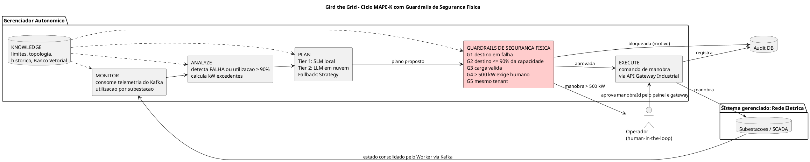

# Ciclo Autonômico MAPE-K, IA-Native e Guardrails de Segurança Física

**Responsável:** Matheus Sobolewski Torquato (Executor & Especialista em IA-Native & Autonomia)

## 1. Diagrama do ciclo MAPE-K com Guardrails

> Diagrama em **PlantUML**: arquivo [`mapek-guardrails.puml`](mapek-guardrails.puml). Para visualizar, copie o código abaixo e cole em https://www.plantuml.com/plantuml



## 2. Fases

| Fase | O que faz |
|---|---|
| **Monitor** | Consome do Kafka `estado-subestacao.v1`, publicado pelo Worker com a carga agregada por subestação e com o status e a capacidade informados pelo SCADA |
| **Analyze** | Identifica sintomas: subestação em falha (carga órfã) ou acima de 90% da capacidade |
| **Plan** | Gera o plano de transferências de carga (IA com Model Tiering + fallback Strategy) |
| **Execute** | Envia ao SCADA só as manobras aprovadas pelos guardrails e registra tudo na auditoria |
| **Knowledge** | Limites físicos, topologia da rede, histórico de ciclos e manuais (Banco Vetorial) |

## 3. Guardrails de segurança física

| Regra | Descrição | Motivo |
|---|---|---|
| G1 | Nunca enviar carga para subestação em **falha** | Não reenergizar equipamento danificado |
| G2 | Destino deve ficar **≤ 90%** da capacidade após a manobra | Margem para picos; evita falha em cascata |
| G3 | Carga da manobra deve ser **positiva e ≤ carga da origem** | Barra números alucinados pela IA |
| G4 | Manobras **> 500 kW** exigem **aprovação humana** | Supervisão em ações de alto impacto |
| G5 | Origem e destino devem existir e ser do **mesmo tenant** | Isolamento multi-tenant |

A validação é **cumulativa**: cada manobra aprovada atualiza o estado simulado usado para validar a próxima.

## 4. Arquitetura AI-Native

- **Model Tiering:**
  - **Tier 1, SLM local:** baixa latência, sem custo por token e sem saída de dados da concessionária.
  - **Tier 2, LLM em nuvem:** usado se o SLM falhar ou responder fora do schema.
  - **Fallback determinístico:** Strategy `ProporcionalFolga` ou `MaiorFolgaPrimeiro`. O ciclo nunca para por causa da IA.
- **RAG:** o planejador consulta o **Banco Vetorial** (manuais de operação, procedimentos PRODIST, incidentes anteriores) para contextualizar o plano.
- **Strategy (GoF):** `EstrategiaRedistribuicao` permite trocar o algoritmo de redistribuição sem if/else.

## 5. Guardrails de IA

- **Entrada, higienização de PII:** o prompt leva só IDs técnicos de subestação e números, sem nome, CPF ou endereço.
- **Saída estruturada:** a resposta deve seguir o JSON Schema abaixo; se não seguir, o sistema passa para o próximo tier.

```json
{
  "type": "object",
  "required": ["transferencias"],
  "properties": {
    "transferencias": {
      "type": "array",
      "items": {
        "type": "object",
        "required": ["origem", "destino", "carga_kw"],
        "properties": {
          "origem": { "type": "string" },
          "destino": { "type": "string" },
          "carga_kw": { "type": "number", "exclusiveMinimum": 0 }
        }
      }
    }
  }
}
```

- **Palavra final:** a IA apenas sugere. A decisão é dos guardrails determinísticos.

## 6. Cenário exemplo

S1 (1000 kW, **em falha**, 400 kW órfãos), S2 (300/1000 kW) e S3 (550/1000 kW):

1. **Monitor** lê as três subestações.
2. **Analyze** encontra 400 kW excedentes em S1.
3. **Plan:** a IA sugere mover os 400 kW para S3.
4. **Guardrail G2 bloqueia**, porque S3 ficaria em 95%.
5. O fallback Strategy divide 400 kW entre S2 e S3, e as duas ficam ≤ 90%. A manobra é executada e auditada.

## 7. Como funcionaria a validação (explicação)

> Explicação de como cada validação seria implementada e testada; não é código da entrega.

### 7.1 Higienização de PII (antes de chamar o modelo)

1. O montador de prompt recebe **apenas** objetos do domínio da rede: subestação, carga, capacidade e status. Ele **não tem acesso** ao Cadastro de Clientes; essa separação é garantida pela ACL.
2. Antes do envio, um filtro procura padrões de dados pessoais (CPF, e-mail, telefone, nomes de campos como `nome` e `endereco`). Se encontrar algum, **bloqueia o envio** e registra o evento na auditoria.
3. **Teste:** o teste monta um prompt a partir de uma rede de exemplo e verifica que ele não contém nenhum desses padrões. Um segundo teste injeta um CPF de propósito e confirma que o envio é bloqueado.

### 7.2 Saída estruturada (JSON Schema)

1. A chamada ao SLM/LLM pede resposta no formato *Structured Output* com o schema da seção 5.
2. A resposta passa por um validador de JSON Schema. Ela é **rejeitada** se:
   - não for JSON;
   - faltar `origem`, `destino` ou `carga_kw`;
   - `carga_kw` for ≤ 0 ou não for número.
3. Se a resposta for rejeitada, o sistema tenta o próximo tier (LLM em nuvem) e, por fim, o fallback Strategy.
4. **Teste:** um modelo falso responde texto livre ("mova a carga para S2"). O teste confirma que a resposta foi rejeitada e que o plano final veio do fallback.

### 7.3 Guardrails de segurança física

1. O plano aprovado pelo schema é simulado manobra a manobra sobre uma **cópia** do estado da rede.
2. Cada manobra passa pelas regras G1 a G5. As aprovadas atualizam a cópia, para que a próxima seja validada já considerando as anteriores.
3. O resultado sai separado em três listas: **aprovadas** (vão para o SCADA), **aguardando humano** (> 500 kW) e **bloqueadas** (com o motivo).
4. **Testes:**

| Cenário de teste | Resultado esperado |
|---|---|
| IA manda 400 kW para S3 (ficaria em 95%) | Bloqueada por **G2** |
| IA manda carga para subestação em falha | Bloqueada por **G1** |
| IA inventa 9.999 kW (mais do que a origem tem) | Bloqueada por **G3** |
| Origem **A** (capacidade 5.000 kW, **em falha**, 3.000 kW órfãos) → destino **B** (capacidade 5.000 kW, carga 0 kW, operando, mesmo tenant): manobra de 3.000 kW | Passa em G1 (B operando), G2 (B fica em 3.000/5.000 = 60% ≤ 90%), G3 (3.000 ≤ 3.000 da origem) e G5 (mesmo tenant). Só o **G4** dispara (3.000 > 500 kW), então vai para **aprovação humana** |
| Destino de outro tenant | Bloqueada por **G5** |
| Duas manobras de 200 kW que, somadas, passam de 90% | A segunda é bloqueada (validação cumulativa) |

### 7.4 Strategy

**Teste:** o mesmo cenário roda com `ProporcionalFolga` e com `MaiorFolgaPrimeiro`. As duas estratégias devem redistribuir os 400 kW sem violar nenhum guardrail. Isso prova que trocar o algoritmo não exige mudar o ciclo MAPE-K (OCP).
