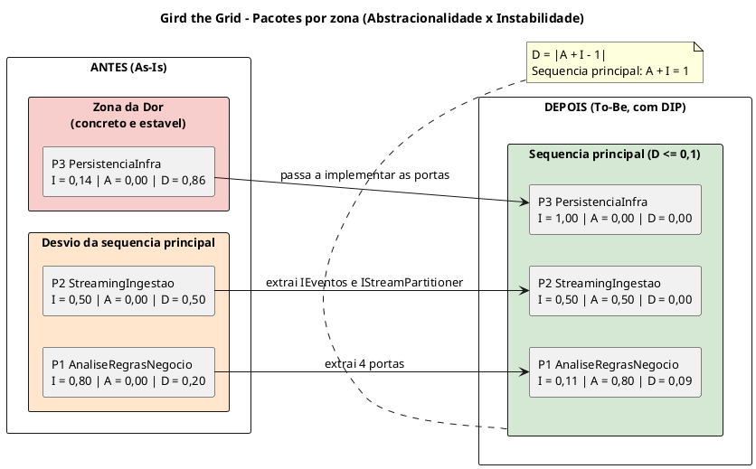

# Relatório de Métricas: Instabilidade (I) e Abstracionalidade (A)

**Responsável:** Felipe Grabias (Executor & QA & Desenvolvedor de Fitness Functions)

Entregável chave do kata: **cálculo/relatório automatizado das métricas quantitativas de código (Instabilidade I e Abstracionalidade A)**.

## 0. Alcance desta entrega

| Item | Situação |
|---|---|
| **Cálculo automatizado sobre o modelo** | ✅ Planilha [`metricas-instabilidade-abstracao.xlsx`](metricas-instabilidade-abstracao.xlsx): as classes e as setas do modelo ficam em tabelas, e **fórmulas** recalculam Ca, Ce, I, A, D, a situação de cada pacote e a Fitness Function (D ≤ 0,1). Mudou uma seta, os números mudam sozinhos. |
| **Relatório e memória de cálculo** | ✅ Este documento. |
| **Automação no CI sobre o código** | ⏳ Proposta (seção 6), não implementada: a Sprint 4 é uma entrega de arquitetura, sem código. |

**Origem dos números (não são ilustrativos):**

- **Antes da refatoração (As-Is):** classes da Tabela 3 do artigo da Sprint 2 da equipe. As setas foram reconstruídas a partir das descrições da seção 7 daquele artigo, no diagrama [`visao-de-pacotes-as-is.puml`](visao-de-pacotes-as-is.puml), e reproduzem exatamente os totais publicados.
- **Depois da refatoração (To-Be):** contagem feita **diretamente nas setas** do diagrama [`visao-de-pacotes-to-be.puml`](visao-de-pacotes-to-be.puml). É a visão de pacotes que serve de base às métricas; o C4 Nível 3 do Ribas mostra os mesmos componentes dentro do contêiner Worker de Regras.

**Escopo:** os três pacotes primários definidos na Sprint 2. `ConectorFactory` (pacote `ingestao`, Serviço de Ingestão) e `EstrategiaRedistribuicao` (pacote `autonomia`, MAPE-K) entraram na Sprint 4 e ficam fora da medição.

## 1. Fórmulas (Robert C. Martin)

Contagem por **classes distintas**:

| Métrica | Fórmula | Leitura |
|---|---|---|
| Ca (acoplamento aferente) | nº de classes **fora** do pacote que dependem de alguma classe **de dentro** | Responsabilidade |
| Ce (acoplamento eferente) | nº de classes **fora** do pacote das quais alguma classe **de dentro** depende | Dependência |
| **I (Instabilidade)** | I = Ce / (Ca + Ce) | 0 = estável, 1 = instável |
| **A (Abstracionalidade)** | A = Nc / Na (abstratas / total) | 0 = concreto, 1 = abstrato |
| D (Distância) | D = \|A + I − 1\| | 0 = na sequência principal |

Classificação usada: D ≤ 0,1 é **sequência principal**; D ≥ 0,7 é **Zona da Dor** (A + I < 1) ou **Zona da Inutilidade** (A + I > 1); entre os dois, **desvio**.

## 2. Estado original (As-Is)

| Pacote | Na | Nc | Ca | Ce | I | A | D | Situação |
|---|---|---|---|---|---|---|---|---|
| P1 · AnaliseRegrasNegocio | 5 | 0 | 1 | 4 | 0,80 | 0,00 | 0,20 | Desvio |
| P2 · StreamingIngestao | 4 | 0 | 2 | 2 | 0,50 | 0,00 | 0,50 | Desvio |
| P3 · PersistenciaInfra | 6 | 0 | 6 | 1 | 0,14 | 0,00 | 0,86 | **Zona da Dor** |

Somente o **P3** estava na Zona da Dor. P1 e P2 estavam em desvio.

### Memória de cálculo (As-Is)

- **P1:** usado por `ApiGatewayController` (Ca = 1); depende de `MedidorDriver`, `ScadaConnector`, `TimeSeriesRepository` e `KafkaEventBroker` (Ce = 4). I = 4 / (1 + 4) = **0,80**; A = 0 / 5 = **0,00**; D = \|0,00 + 0,80 − 1\| = **0,20**
- **P2:** usado por `GeradorAlertaOperacional` e `ApiGatewayController` (Ca = 2); depende de `TimeSeriesRepository` e `AuditDbAdapter` (Ce = 2). I = 2 / 4 = **0,50**; A = 0 / 4 = **0,00**; D = **0,50**
- **P3:** usado por `AnalisadorTelemetriaService`, `ProcessadorRegrasRede`, `ConsolidadorDashboard`, `DetectorIntrusaoSec`, `TelemetryStreamConsumer` e `IngestaoBatchBuffer` (Ca = 6); depende de `EnvSecurityConfig` (Ce = 1). I = 1 / 7 = **0,14**; A = **0,00**; D = **0,86**

## 3. Estado refatorado com DIP (To-Be), recontado pelo desenho

| Pacote | Na | Nc | Ca | Ce | I | A | D | Situação |
|---|---|---|---|---|---|---|---|---|
| P1 · AnaliseRegrasNegocio | 5 | 4 | 8 | 1 | 0,11 | 0,80 | 0,09 | Sequência principal |
| P2 · StreamingIngestao | 4 | 2 | 2 | 2 | 0,50 | 0,50 | 0,00 | Sequência principal |
| P3 · PersistenciaInfra | 6 | 0 | 0 | 3 | 1,00 | 0,00 | 0,00 | Sequência principal |

### Memória de cálculo (To-Be)

- **P1:** usado por `ApiGatewayController`, `TelemetryStreamConsumer`, `TimeSeriesRepository`, `AuditDbAdapter`, `ScadaAdapter`, `MedidorAdapter`, `SiemAdapter` e `LegadoAdapter` (Ca = 8); depende de `IEventos` (Ce = 1). I = 1 / (8 + 1) = **0,11**; A = 4 / 5 = **0,80**; D = \|0,80 + 0,11 − 1\| = **0,09**
- **P2:** usado por `ApiGatewayController` e `MotorAnaliseRegrasService` (Ca = 2); depende de `ITelemetria` e `IPersistencia` (Ce = 2). I = 2 / 4 = **0,50**; A = 2 / 4 = **0,50**; D = **0,00**
- **P3:** ninguém de fora depende dele (Ca = 0); depende de `ITelemetria`, `IPersistencia` e `IIntegracaoExterna` (Ce = 3). I = 3 / 3 = **1,00**; A = 0 / 6 = **0,00**; D = **0,00**

### Diferença em relação ao publicado na Sprint 2

| Pacote | Publicado na Sprint 2 | Recontado pelo desenho | Motivo |
|---|---|---|---|
| P1 | Ca = 4 → I = 0,20, D = 0,00 | **Ca = 8** → I = 0,11, D = **0,09** | A Sprint 2 contou "os adaptadores de P3 e o Gateway" como 4 classes. Pelo desenho, os **6** adapters de P3 implementam portas de P1, e o `TelemetryStreamConsumer` (P2) também usa portas de P1. |
| P3 | Ce = 4 | **Ce = 3** | No desenho, nenhuma classe de P3 depende de `IEventos`. P3 depende apenas de `ITelemetria`, `IPersistencia` e `IIntegracaoExterna`. O I de P3 continua 1,00. |

**Conclusão da reconciliação:** os três pacotes continuam dentro da Fitness Function **D ≤ 0,1**. A recontagem só muda o P1 de 0,00 para 0,09.

## 4. Gráfico A × I

> Diagrama em **PlantUML**: arquivo [`zonas-a-i.puml`](zonas-a-i.puml). Para visualizar, copie o código abaixo e cole em https://www.plantuml.com/plantuml

Diagramas-base das contagens: [`visao-de-pacotes-as-is.puml`](visao-de-pacotes-as-is.puml) e [`visao-de-pacotes-to-be.puml`](visao-de-pacotes-to-be.puml).

## 5. Como a planilha calcula (automação sobre o modelo)

1. **Abas `*_Classes`:** uma linha por classe, com pacote (P1, P2, P3 ou Externo) e tipo (Interface, Abstrata ou Concreta).
2. **Abas `*_Dependencias`:** uma linha por seta do diagrama. O pacote de cada ponta é buscado por fórmula (PROCV).
3. Para cada classe, fórmulas (CONT.SES) marcam se ela **depende de** e se é **usada por** cada pacote.
4. **Aba `Metricas`:**
   - Ca = soma das classes de fora que dependem do pacote;
   - Ce = soma das classes de fora usadas pelo pacote;
   - em seguida I, A, D, a situação e a Fitness Function (**OK** em verde e **VIOLA** em vermelho).
5. As colunas "Sprint 2" ficam ao lado, para comparação.

**Teste rápido:** na aba `ToBe_Dependencias`, adicione a linha `MotorAnaliseRegrasService → TimeSeriesRepository` (o núcleo usando a infraestrutura direto). P3 passa a ter Ca = 1, então I = 3/4 = 0,75 e D = 0,25, e a Fitness Function marca **VIOLA** no P3. Isso mostra que o núcleo voltou a depender de uma classe concreta.

## 6. Automação no CI (proposta, não implementada nesta entrega)

Quando houver código, o mesmo cálculo rodará no pipeline a cada Pull Request:

1. Lê as dependências entre classes compiladas e conta classes concretas e abstratas.
2. Gera as mesmas tabelas da planilha.
3. Publica o relatório como artefato do build.
4. **Falha o build** se algum pacote primário passar de **D > 0,1**.

## 7. Conclusão

Com o DIP, o P3 (PersistenciaInfra) sai da Zona da Dor (D de 0,86 para 0,00): fica instável (I = 1) e nenhuma classe de fora depende dele. O núcleo de regras (P1) fica abstrato e estável (A = 0,80, I = 0,11, D = 0,09). Os três pacotes primários terminam dentro da Fitness Function D ≤ 0,1.
