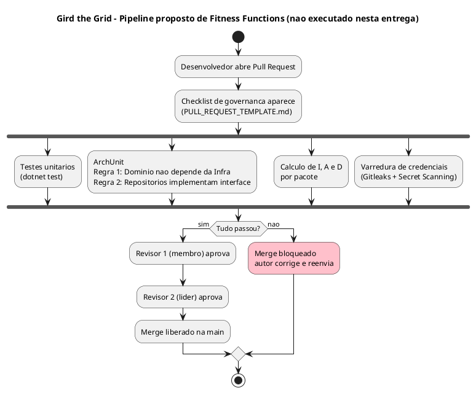

# Testes & Fitness Functions (Governança Automatizada)

**Responsável:** Felipe Grabias (Executor & QA & Desenvolvedor de Fitness Functions)

> **Status:** testes **propostos, não executados**. A Sprint 4 é uma entrega de arquitetura, sem código. Este documento define as regras e explica como cada teste funcionará quando o código existir.

## 1. O que é uma Fitness Function de arquitetura

É um teste automatizado que verifica se o código continua obedecendo às decisões arquiteturais. Com o **ArchUnit**, as regras de dependência entre camadas são escritas como testes unitários. Se alguém quebrar uma regra, o pipeline de CI falha e o Pull Request não pode ser mergeado.

## 2. Regras propostas (ArchUnit)

### Regra Proposta 1: o Domínio não referencia a Infraestrutura

| Item | Valor |
|---|---|
| Pacotes de domínio | `br.com.girdthegrid.analiseregrasnegocio`, `br.com.girdthegrid.autonomia` |
| Pacote proibido | `br.com.girdthegrid.persistenciainfra` |
| Garante | ADR-002 (DIP) e ADR-004 (ACL) |

```text
noClasses().that().resideInAPackage("..analiseregrasnegocio..")
    .or().resideInAPackage("..autonomia..")
    .should().dependOnClassesThat().resideInAPackage("..persistenciainfra..")
```

### Regra Proposta 2: todo repositório implementa uma interface abstrata

| Item | Valor |
|---|---|
| Classes alvo | nomes terminados em `Repository` ou `Adapter` |
| Condição | implementar uma porta (`ITelemetria`, `IPersistencia`, `IIntegracaoExterna`, `IEventos`) |
| Garante | DIP + ISP |

```text
classes().that().haveSimpleNameEndingWith("Repository")
    .or().haveSimpleNameEndingWith("Adapter")
    .should().implement(interfaceDoDominio())
```

## 3. Fitness Functions de qualidade (das sprints anteriores)

| Dimensão | Função de aptidão | Meta |
|---|---|---|
| Disponibilidade | Tempo disponível / tempo total | ≥ 99,99% |
| Desempenho | Latência P95 do dashboard / P99 do alerta | ≤ 2 s / ≤ 100 ms |
| Carga | Vazão sob pico de 3x | ≥ 19k eventos/s |
| Recuperação | RTO e RPO em falha de região | RTO reduzido / RPO ≈ 0 |
| Acoplamento | Distância da sequência principal (D) dos pacotes primários | D ≤ 0,1 |

## 4. Onde roda

> Diagrama em **PlantUML**: arquivo [`pipeline-fitness-functions.puml`](pipeline-fitness-functions.puml). Para visualizar, copie o código abaixo e cole em https://www.plantuml.com/plantuml



## 5. Como funcionaria a validação (explicação)

> Explicação de como cada verificação seria implementada; não é código da entrega.

### 5.1 Regra 1: Domínio não depende da Infraestrutura (ArchUnit)

1. No `dotnet test`, o ArchUnitNET **carrega os assemblies compilados** do projeto e monta um grafo com todas as classes e as dependências entre elas (heranças, campos, parâmetros, chamadas).
2. A regra seleciona as classes dos pacotes `analiseregrasnegocio` e `autonomia` e verifica se **alguma aresta** do grafo aponta para `persistenciainfra`.
3. Se encontrar alguma, o teste **falha** e mostra exatamente qual classe violou a regra. Exemplo: *"MotorAnaliseRegrasService depende de TimeSeriesRepository"*.
4. O pipeline fica vermelho e o GitHub **não libera o merge**.

**Exemplo de violação que seria pega:** um desenvolvedor, com pressa, cria `new TimeSeriesRepository()` dentro do motor de regras em vez de receber `IPersistencia` pelo construtor.

### 5.2 Regra 2: todo repositório implementa uma interface abstrata (ArchUnit)

1. A regra seleciona as classes cujo nome termina em `Repository` ou `Adapter`.
2. Para cada uma, verifica se ela **implementa** pelo menos uma das portas do domínio (`ITelemetria`, `IPersistencia`, `IIntegracaoExterna`, `IEventos`).
3. Uma classe concreta "solta", sem interface, falha o teste. Isso garante que o domínio sempre poderá trocar a implementação (DIP).

### 5.3 Cálculo automático de I e A

1. Um passo do CI percorre as classes compiladas e agrupa por pacote.
2. Para cada pacote, conta:
   - **Na:** total de classes; **Nc:** quantas são interfaces ou abstratas;
   - **Ca:** quantas classes de **fora** dependem de alguma classe de dentro;
   - **Ce:** de quantas classes de fora as classes de dentro dependem.
3. Calcula **I = Ce / (Ca + Ce)**, **A = Nc / Na** e **D = |A + I − 1|**.
4. Gera a tabela do [relatório de métricas](../metricas/relatorio-instabilidade-abstracao.md) e a anexa ao build.
5. **Falha o build** se um pacote primário passar de D > 0,1 ou se o núcleo (`analiseregrasnegocio`) ficar com I > 0,3. Esse é o item "Métricas de Código" do checklist.

### 5.4 Segurança & Credenciais

1. A cada push, o CI roda uma ferramenta de varredura de segredos (ex.: **Gitleaks**), e o repositório tem o **GitHub Secret Scanning** ativado.
2. A ferramenta procura padrões de chaves de API, tokens, senhas e strings de conexão em **todo o histórico** do commit.
3. Se achar algo, o build falha e o segredo precisa ser **revogado** (não basta apagar do arquivo, porque ele continua no histórico do Git).
4. Senhas reais ficam somente em **GitHub Secrets** / cofre de segredos, nunca no código.

## 6. Mapa: item do checklist de PR → onde é validado

| Item do checklist | Como é validado | Responsável |
|---|---|---|
| DIP | ArchUnit, Regra 1 | Felipe |
| Repositórios com interface | ArchUnit, Regra 2 | Felipe |
| Fitness Functions (`dotnet test`) | Pipeline CI | Felipe |
| Métricas de Código (I) | Cálculo automático de I, A e D | Felipe |
| Segurança & Credenciais | Gitleaks + GitHub Secret Scanning | Felipe |
| Contratos de Interface | Teste de contrato com os schemas | Darlan |
| Falhas Parciais (Polly) | Teste com servidor falso fora do ar | Darlan |
| Poison Pills / DLQ | Teste com mensagem quebrada | Darlan |
| IA: JSON Schema + Guardrails | Testes de cenário do MAPE-K | Torquato |
| PII | Teste de higienização do prompt | Torquato |
| Linguagem Ubíqua / Bounded Contexts / ACL | Revisão humana contra o glossário | João |
| C4, ADR, README | Revisão humana | Ribas |
